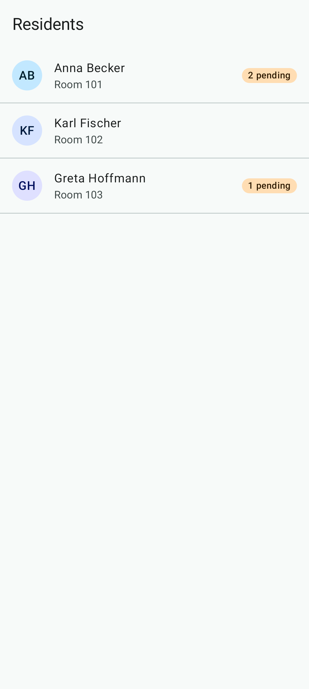
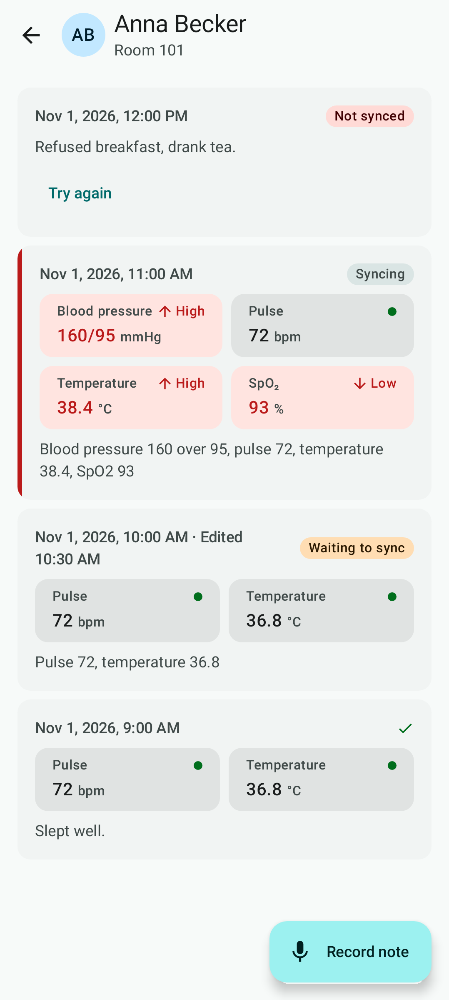
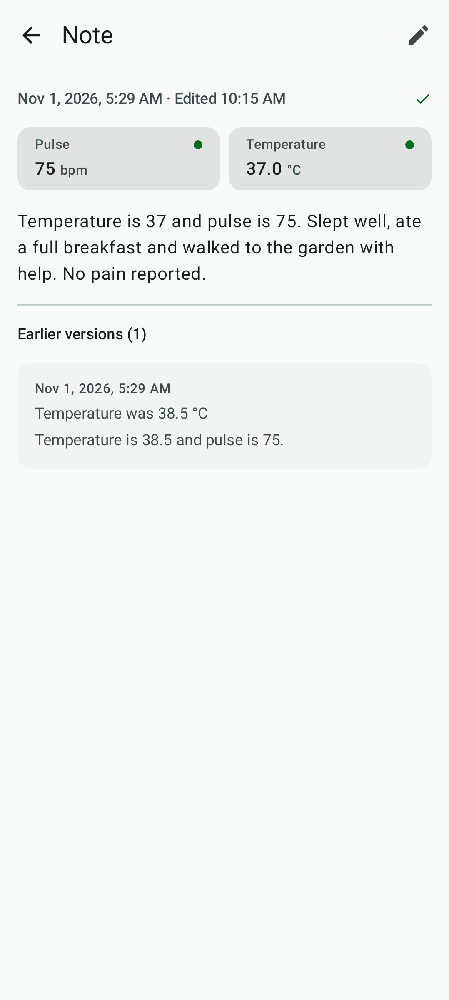
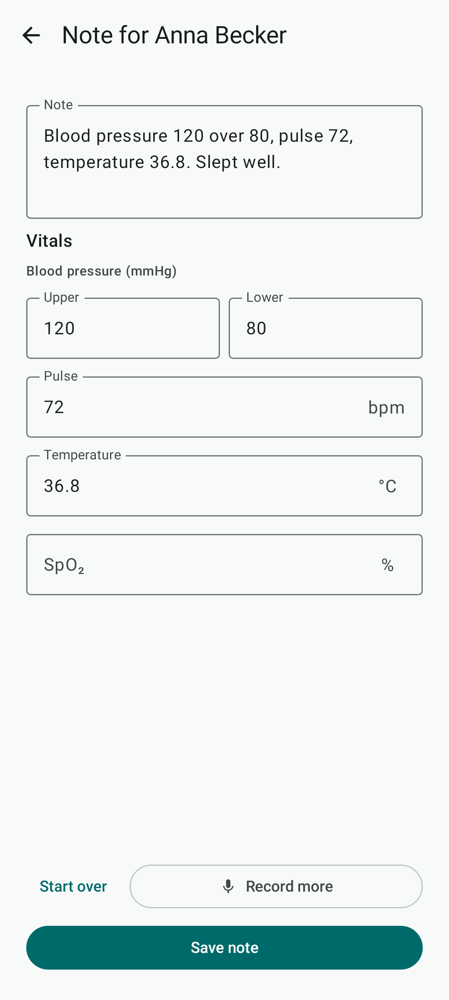
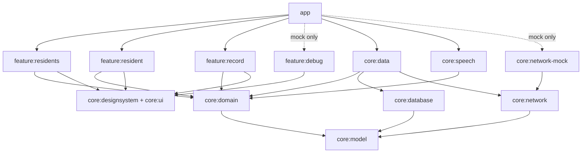
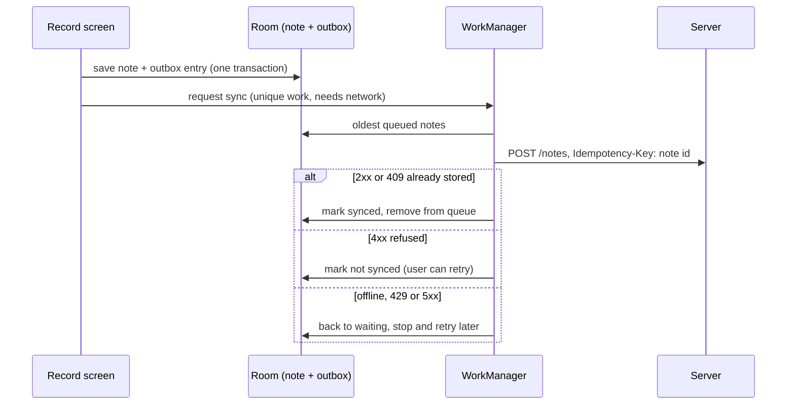

# CareNote

[](https://github.com/enghossamelsawy/CareNote/actions/workflows/ci.yml)

An offline-first Android app for care staff. Dictate a note for a resident, check the transcript and the
vital signs read from it, and save it. The note is stored on the phone straight away and sent to the server
whenever there is a connection, so a dead spot in the building never loses a word.

<p>
  
  
  
  
</p>

*These are the screenshot tests' recorded images, so they always show the current UI.*

## Features

- **Dictate, review, save.** Speech becomes text, and blood pressure, pulse, temperature and SpO₂ are read
  out of it ("pulse is about 72" works too). Every value can be corrected by hand before saving.
- **Record more.** Dictate the temperature, then the pulse: each recording adds to the note instead of
  replacing it.
- **Values that need attention stand out.** Normal readings stay calm; a value outside the usual adult range
  gets a red tile with "▲ High" or "▼ Low", and its note a red edge in the list.
- **Edits keep the history.** Editing a note saves a new version; the note shows "Edited 10:15 AM" and its
  earlier versions stay readable.
- **Works offline.** Notes save locally and sync later, with a clear status on each one: waiting, syncing,
  synced or not synced (with retry).
- **Debug menu** (mock build only): take the server offline, make requests fail or slow them down, and see
  which speech engine was used.

## Architecture

Clean Architecture with a strict dependency rule, split into Gradle modules. Arrows point at what a module
depends on.



- **`core:model` and `core:domain` are plain Kotlin (JVM) modules.** The domain owns the interfaces
  (`CareNoteRepository`, `SyncScheduler`, `SpeechTranscriber`, `NetworkMonitor`), the use cases and the vitals
  parser, so the business rules are tested without Android.
- **ViewModels only call use cases**, never repositories. This is a project rule for consistency, not a law of
  Clean Architecture: some use cases are thin pass-throughs on purpose, so no screen ever depends on a
  repository. The mock-only debug menu is the one documented exception; it drives the mock server directly.
- **Features never depend on each other.** Each exposes a navigation key and an entry; only `app` connects
  them (Navigation 3), and it is also the only module with build flavors.
- **MVI on every screen:** a `State`, `Intent`s in, one-off `Effect`s out. A stateless `Screen` composable
  is driven by a `Route` that holds the ViewModel, so screens preview and screenshot-test without Hilt.
- **Design tokens only.** Screens read colors, type, spacing and sizes from `CareNoteTheme`; raw colors and
  dp values live only in `core:designsystem`. Dynamic color is off, so "not synced" looks the same on every
  phone.

## Offline-first sync

Saving never waits for the network. The note and its place in the sync queue (the outbox) are written in
**one Room transaction**, so a note can't exist without being queued.



- **The note id is the idempotency key.** It's made on the phone, so every retry sends the same id; if a
  note reached the server before a crash or timeout, the server answers 409 and the app treats it as stored.
  A note is never stored twice.
- **Oldest first, stop at the first "try later".** If the server is down for one note it's down for all,
  so the worker stops instead of failing each one. "Oldest" means the order notes were saved in, numbered
  in the database, not a clock time: a retried note keeps its place, so an original always goes before its
  edit, even if the phone's clock was changed. A note the
  server *refuses* is set aside as "not synced" and the queue moves on. Retry only works on such a note, so
  a double tap or a note that synced meanwhile changes nothing.
- **One sync at a time.** Unique work (`note-sync`, `APPEND_OR_REPLACE`) only runs with a network and
  backs off exponentially from 30 seconds. A note saved during a sync is picked up right after it.

## Edits are revisions, not updates

Editing a note saves a **new note** whose `revisionOf` points at the version it replaces; nothing is ever
changed or deleted.

- **Sync stays insert-only.** Edits travel through the same outbox and idempotency key as new notes. The
  queue follows save order, so the original is sent before its edit, retries included; if the server refuses
  the original, the edit still syncs on its own, and the note says "An earlier version isn't synced" with a
  retry on that version.
- **The record stays auditable**, which care documentation requires: every version is kept locally and on
  the server, and the note screen shows the earlier ones.
- **Only the latest version can be edited**, so the history never splits in two.
- The list shows the latest version at the time the note was first written, marked "Edited".

## Speech

`SpeechTranscriber` is a domain interface; `core:speech` picks the first engine that is ready on the phone:

1. **ML Kit GenAI speech recognition** (Basic mode, Android 12+). The model runs on the phone, so audio never
   leaves it.
2. **Android's own `SpeechRecognizer`.** The app asks for on-device recognition, but that is only a request:
   depending on the phone's speech service, audio may be sent over the network.
3. **A demo engine** that "hears" a sample note. Mock build only, so the app can be demoed on an emulator.

Care data stays on the phone and leaves it only through sync: the app is excluded from cloud backup and
device-to-device transfer.

The vitals parser is built from a per-language vocabulary, so adding German means adding a vocabulary, not
changing the parser. minSdk is 26; newer speech features are checked at runtime.

## Build flavors

| Flavor | Server | Use |
|---|---|---|
| `mock` | An in-process mock server behind an OkHttp interceptor, controlled from the debug menu | Demos and development without a backend |
| `prod` | `https://api.carenote.example/` | What would ship |

Only `app` has flavors; libraries get what differs through Hilt.

```bash
./gradlew installMockDebug
```

## Testing

- **Unit tests** in given/when/then style, with in-memory fakes for every repository in `core:testing`.
  The domain (use cases, vitals parser, edit history) runs on the plain JVM.
- **Robolectric** for Room DAOs, repositories and the sync worker logic.
- **Screenshot tests** with Roborazzi for every screen, in light and dark. Images live next to the tests in
  `src/test/screenshots`.
- **ktlint** with the Compose rules; import ordering is left to the IDE.

```bash
# What CI runs
./gradlew ktlintCheck lintDebug lintMockDebug lintProdDebug test assembleMockDebug assembleProdDebug

# Screenshots: compare with the recorded images, or record new ones after a UI change
./gradlew verifyRoborazziDebug
./gradlew recordRoborazziDebug
```

CI (GitHub Actions) runs ktlint, Android Lint, all unit tests, both flavor builds and compiles the device
tests on every push and pull request. Screenshots are checked locally for now: the images are recorded on
Windows, and CI's Linux renders a few pixels differently.

## Tech stack

| Area | Library |
|---|---|
| Build | AGP 9.5 with built-in Kotlin 2.4, KSP, convention plugins in `build-logic` |
| UI | Jetpack Compose (BOM 2026.09), Material 3, Navigation 3 |
| DI | Hilt, assisted injection for ViewModels with arguments |
| Data | Room, WorkManager, Coroutines and Flow |
| Network | Retrofit 3, OkHttp 5, kotlinx.serialization |
| Speech | ML Kit GenAI speech recognition |
| Tests | JUnit 4, Turbine, Robolectric, Roborazzi |
| Quality | ktlint with Compose rules, Android Lint |

## Known limitations

Found in review and planned next:

- **No typing without dictating.** A note starts with a recording, so a phone without speech recognition,
  or with the microphone refused, can't create one.
- **Earlier versions show their text only**, not their vitals, so a corrected pulse doesn't show what changed.

## Decisions and trade-offs

- **An outbox instead of sending on save.** Saving is instant and can't fail because of the network, and a
  crash between "saved" and "sent" can't lose a note. The cost is a sync status the user has to understand,
  which is why every note shows one.
- **Ids made on the phone.** They make retries safe without asking the server for an id first, which
  wouldn't work offline.
- **Revisions instead of updates.** No update conflicts to resolve in sync, and an audit trail for free. The
  cost is more rows and a little work to find the latest version.
- **A mock flavor instead of a fake backend.** The whole app, including failure cases, runs on any phone
  with no setup, and the debug menu makes "the server is down" a switch.
- **Next steps** with a real backend: authentication, resolving edits of the same note made on two phones,
  and more parser languages.
